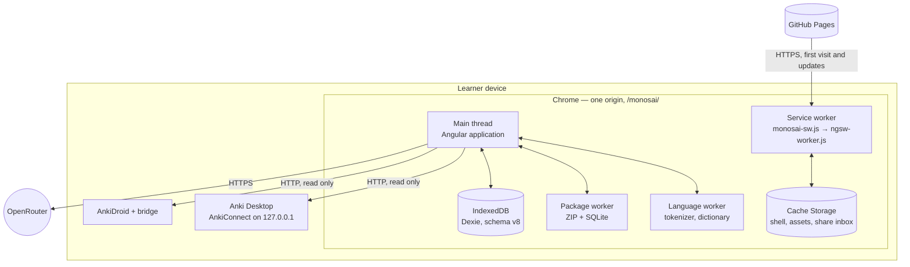
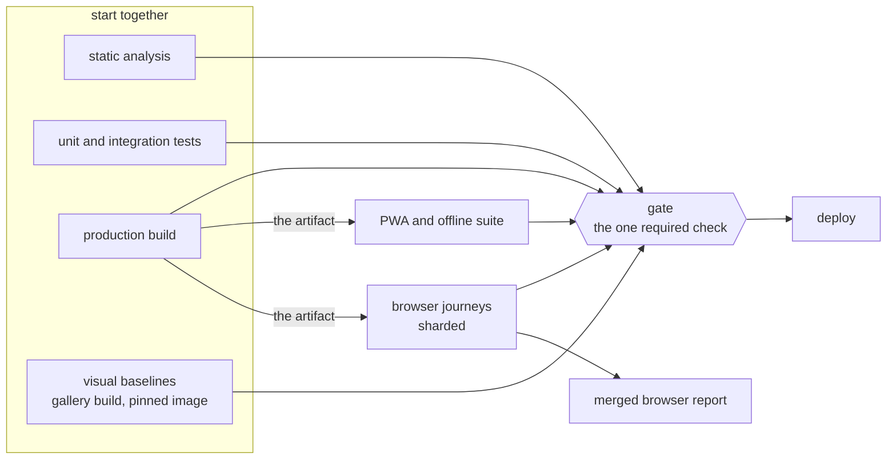

# 7. Deployment View

## 7.1 Infrastructure Level 1

The PWA runs from GitHub Pages. An optional separately installed Android 16+
bridge serves loopback port 8765 and reads a local AnkiDroid 2.24+ installation.
The bridge's APK lifecycle is independent of the Pages artifact and service worker.

| Infrastructure element      | Building blocks it runs                                         | Why here                                                                                                                                                                                                                               |
| --------------------------- | --------------------------------------------------------------- | -------------------------------------------------------------------------------------------------------------------------------------------------------------------------------------------------------------------------------------- |
| **Main thread**             | `core/`, `features/`, `application/`, most of `infrastructure/` | The user interface and every use case                                                                                                                                                                                                  |
| **Language worker**         | `web/src/workers/language/`                                     | The tokenizer is WebAssembly and the dictionary index is large. Neither may block the reader. See [ADR 0005](../decisions/0005-tokenizer-selection.md)                                                                                 |
| **Package worker**          | `web/src/workers/package/`                                      | Reading a package means unzipping and then querying SQLite. Both are slow, and both handle untrusted input. See [ADR 0016](../decisions/0016-anki-package-parsing.md)                                                                  |
| **Service worker**          | Monosai's own worker, wrapping the framework's                  | Offline shell, asset caching, and the Android share target. Monosai's worker handles the share `POST` and hands everything else to the framework's worker unchanged. See [ADR 0036](../decisions/0036-android-package-share-target.md) |
| **IndexedDB**               | Every Dexie repository                                          | All learner data. Survives a reload and a reinstall of the shell                                                                                                                                                                       |
| **Cache Storage**           | Shell, icons, language assets, share inbox                      | Makes the offline start possible, and is where a shared package waits                                                                                                                                                                  |
| **GitHub Pages**            | The built artifact                                              | Static hosting, no server logic, served under an application base path                                                                                                                                                                 |
| **Anki on the same device** | None. External                                                  | The vocabulary source. Reached over loopback HTTP, never over the internet                                                                                                                                                             |
| **Monosai Bridge**          | `android-bridge/app/`                                           | Idle foreground listener, query-only ContentProvider access, optional boot restart. No polling or wake locks; no notification permission request                                                                                       |
| **The AI service**          | None. External                                                  | Text and speech, paid by the learner                                                                                                                                                                                                   |

Quality properties of this topology: the browser holds every piece of learner data, so there is
nothing to breach on a server. Updates download in the background and apply on the next launch, never in
a running page ([ADR 0094](../decisions/0094-updates-apply-on-the-next-launch.md)).

## 7.2 Infrastructure Level 2: the build and delivery pipeline

One workflow builds the application exactly once and then reuses that artifact everywhere, so the
deployed bytes are the tested bytes. [`ci.yml`](../../.github/workflows/ci.yml) is the authority for
the steps; what follows is the shape and the reason for it.

Local development and CI use the exact Node release in [`.nvmrc`](../../.nvmrc). The synthetic Anki
fixtures depend on Node's bundled SQLite and compression implementations, so a runtime upgrade must
verify or regenerate those fixtures in the same change. A floating major version would allow an
unchanged checkout to fail the byte-for-byte reproducibility check after a runner update.

Parallel local worktrees do not share a port. The main checkout and CI use 4200, 4210, 4300, 4310
and 4220 for the development server, the end-to-end suite, the PWA suite, the visual suite and the
screenshot scenarios;
[`worktree-ports.mjs`](../../web/scripts/worktree-ports.mjs) gives each linked worktree a stable set
derived from its path, and so a browser origin of its own. A local end-to-end run rebuilds only when
[`build-if-stale.mjs`](../../web/scripts/build-if-stale.mjs) finds a changed input; CI still builds
once and passes the artifact on.

| Stage                          | Responsibility                                                                                                                                                                                                                                                                                                                                                                   |
| ------------------------------ | -------------------------------------------------------------------------------------------------------------------------------------------------------------------------------------------------------------------------------------------------------------------------------------------------------------------------------------------------------------------------------- |
| **Static analysis**            | Formatting, linting including the layer zones, the design checks of `npm run design:check` (component style tokens, the template and copy rules, the Android bridge colours, and the composition allowlist: features and core may not gain styles, native popovers, raw `
`, or `PopoverService` outside the reader; the checked-in exemption lists may only shrink against the base revision), type checking, generated assets and fixtures, icons, licences, and a dependency audit |
| **Unit and integration tests** | The full unit suite, held to the coverage thresholds the build configuration declares                                                                                                                                                                                                                                                                                            |
| **Production build**           | Produces the one artifact. Verifies that it contains everything a deployed Progressive Web App needs, that its base path is right and that it holds nothing of the development-only gallery, and holds it to the declared bundle budgets. On the default branch it also uploads the artifact's Pages copy for the deploy                                                                                                                                                                                                |
| **Browser journeys**           | Sharded across the desktop and Android lanes. A pull request runs the smoke lane; a push to the default branch runs the full regression lane                                                                                                                                                                                                                                     |
| **PWA and offline suite**      | The same artifact, served locally with the service worker live                                                                                                                                                                                                                                                                                                                   |
| **Visual baselines**           | Builds the development-only `gallery` configuration and compares a screenshot of every gallery page, and of each overlay open, with the committed baselines in `web/e2e-visual/__screenshots__/`: desktop and Android, light and dark. It runs inside the Playwright image the lockfile pins, the image the baselines were drawn in, and uploads the diff report on failure. Only the manual `Visual baselines` workflow redraws and commits baselines                                     |
| **Gate**                       | Fails unless every listed stage succeeded. A stage blocks merging by joining the gate's dependency list, so branch protection never has to be edited                                                                                                                                                                                                                             |
| **Deploy**                     | Runs on the default branch only, after the gate. Publishes the Pages copy of the artifact, which the build uploaded so it is listed well before the deploy asks for it. It never builds                                                                                                                                                                                                                                                                        |

Two rules keep this honest. Nothing except the build stage compiles the shipped application; every test stage
is told through `MONOSAI_PREBUILT_DIST=true` to serve the downloaded artifact rather than build its own. And a stage becomes blocking by
joining the gate, which is why there is exactly one required status check.

The visual stage is the one stage that compiles, and what it compiles never ships: the `gallery`
configuration swaps `core/routing/dev-routes.ts` for a file that adds the primitive gallery, and the
build stage's `verify-dist` fails if the Pages artifact contains any of it. The baselines only mean
something in the image they were drawn in, so `npm run visual` runs the suite there through Docker
on a workstation, and
[`visual-baselines.yml`](../../.github/workflows/visual-baselines.yml), started by hand, is the only
writer: it redraws every baseline in that image, proves they compare clean, and commits them to the
branch it was started on.

The independent `bridge` job uses Java 21 and the Gradle wrapper for JVM tests,
debug APK assembly and a verified runtime licence report; it joins `gate` without
depending on the web build. The one-build rule above concerns the Pages artifact.
`bridge-release.yml` runs on every push to `main`. `android-bridge/version.txt` is
the bridge's version: when it names a version with no release, the workflow tests
and checks licences before decoding signing secrets, then signs a release APK,
creates `bridge-v<version>` from that commit and publishes it to GitHub Releases;
when the release exists but the APK's sources have changed since its tag, it fails
and names them. Verification does not wait on the signing key: with none configured
the lane still tests the bridge it would have published, then warns and publishes
nothing rather than failing the branch. PR jobs have no signing secrets. Version
codes use the bounded calculation Gradle and the in-app update comparison share; the system
installer requires consent ([ADR 0077](../decisions/0077-the-bridge-publishes-itself.md)).
`protocol/` is inside that source comparison, and a contract that rises only inside
a patch release fails the lane, because a patch is a promise that the wire did not
move. The PWA still deploys one verified artifact with no native/web version
binding: the two sides negotiate one contract number and degrade around it rather
than shipping together
([ADR 0078](../decisions/0078-the-bridge-announces-a-contract.md)).
