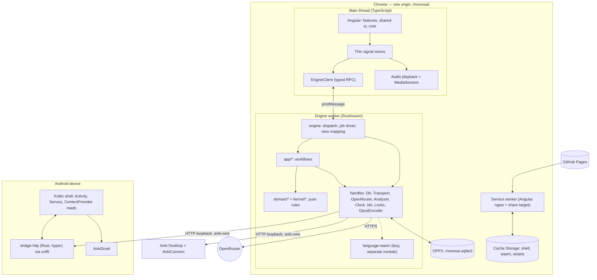
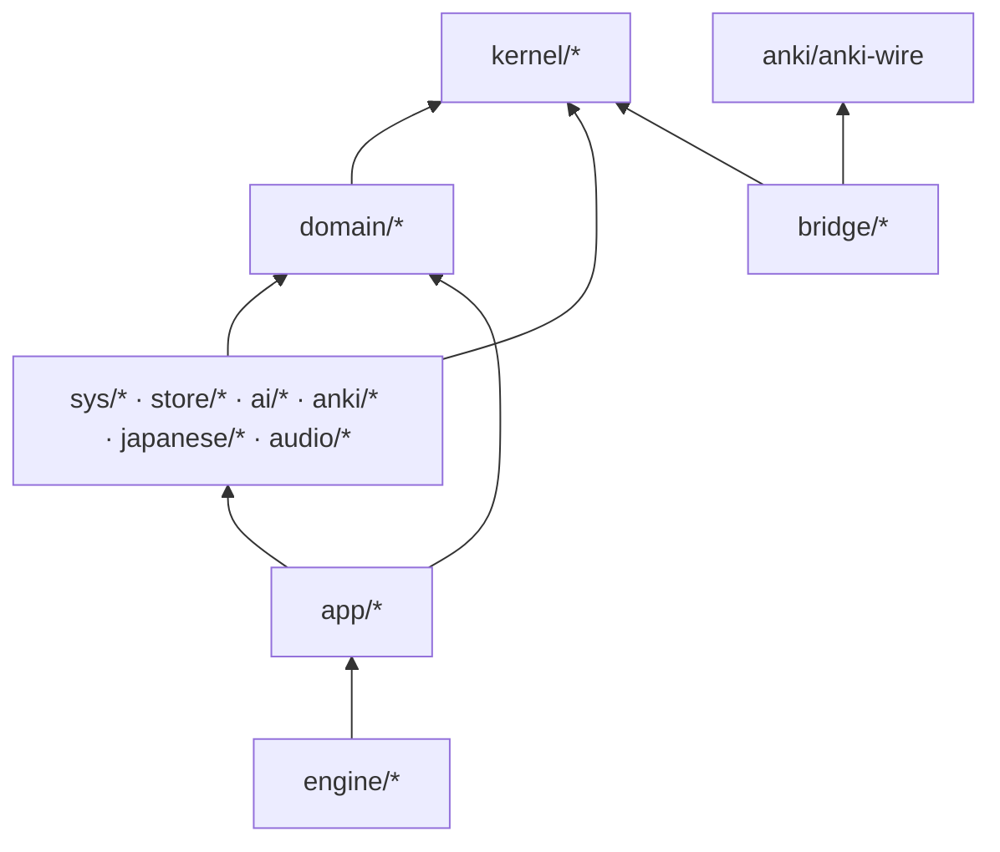

# Monosai in Rust — Target Architecture

Status: proposal, 2026-11-02
Companion documents: [style.md](style.md) (how code is written),
[migration.md](migration.md) (how to get there)

This document describes the architecture Monosai should have once everything
that is not presentation has been rewritten in Rust. It is written for a clean
slate: there are no real users, so stored data, cache keys, hashes, and the
Anki bridge contract do not have to survive the change.

---

## 1. Goals and non-goals

### Goals

1. **Every line of non-presentation logic is Rust.** Domain rules, use cases,
   persistence, the AI client, Anki access, Japanese language processing,
   audio handling, and the Android bridge's network-facing code.
2. **The presentation layer stays Angular.** Components, templates, styles,
   routing, and the design system do not change. Signal stores remain the
   surface components bind to, but they hold state rather than logic.
3. **A functional core with an imperative shell.** Rules are pure functions
   over values. Effects happen in a thin layer of workflows that read, call the
   rules, and write. Only a handful of concrete handle types touch the outside
   world.
4. **Explicit ownership.** One owner for each piece of state, no shared mutable
   state outside handle types, no trait objects, no globals.
5. **Stronger guarantees for code written by coding agents.** Exhaustive
   matching, no null, newtypes, layer rules enforced by the crate graph,
   capabilities limited by dependencies, and a lint set that encodes the
   [style guide](style.md).
6. **Small, focused crates with low incremental compile times.** Heavy
   dependencies are quarantined in leaf crates; most work is testable natively
   with `cargo nextest` on one crate.
7. **One contract per boundary, defined once in Rust.** The UI ↔ engine contract
   and the web ↔ Android bridge contract are each one crate.

### Non-goals

- Backwards compatibility with existing IndexedDB data, cache keys, hashes,
  prompt versions, or older bridge releases.
- A server. Monosai stays local-first, static-hosted on GitHub Pages, with the
  learner's own OpenRouter key.
- Rewriting the UI in a Rust framework (Leptos, Yew, Dioxus).
- Running the Android platform code (Activity, service, ContentProvider access,
  installer) in Rust.

### What Rust does and does not buy

| Rust gives                                                                                    | Rust does not give                                                          |
| --------------------------------------------------------------------------------------------- | --------------------------------------------------------------------------- |
| Exhaustive `match`, no `null`/`undefined`, immutable by default                               | Memory safety over TypeScript (TS is already memory-safe)                   |
| Newtypes that make mixing UTF-8 and UTF-16 offsets, or ids of different kinds, a compile error | Protection from logic bugs, wrong prompts, or wrong SQL                     |
| Layer rules enforced by the crate graph instead of a linter                                   | Safety across the JS boundary: every value entering Rust is still validated |
| Capabilities limited by dependencies: a crate without `transport` cannot touch the network    | A sandbox: wasm glue code runs with the page's full privileges              |
| A sync transaction API that makes holding a transaction across an `await` a compile error     |                                                                             |

---

## 2. System overview



### Runtime units

| Unit                | Runs                                                                                     | Why there                                                                                                       |
| ------------------- | ---------------------------------------------------------------------------------------- | --------------------------------------------------------------------------------------------------------------- |
| **Main thread**     | Angular, thin stores, `EngineClient`, audio playback, MediaSession, `Intl` formatting    | Only the DOM lives here. Nothing here holds learner data beyond what is on screen                               |
| **Engine worker**   | The whole Rust engine: workflows, SQLite, AI, Anki, audio decode and encode, job driving | OPFS sync access handles exist only in dedicated workers; all state has one owner; the main thread never blocks |
| **Language module** | Lindera + IPADIC + dictionary index, loaded lazily inside the engine worker              | 13+ MB of wasm; reading a saved text without new imports never needs it at startup                              |
| **Service worker**  | Angular's `ngsw`, plus Monosai's share-target handler                                    | Offline shell and Android share sheet; unchanged from today                                                     |
| **Android bridge**  | Kotlin shell + `bridge-http` native library                                              | ContentProvider access needs Java APIs; the network-facing listener is Rust                                     |

---

## 3. Repository layout

```
monosai/
├─ Cargo.toml                 workspace: members, [workspace.package|dependencies|lints], profiles
├─ Cargo.lock
├─ rust-toolchain.toml        pinned stable; targets wasm32-unknown-unknown, aarch64/x86_64-linux-android
├─ rustfmt.toml
├─ clippy.toml                disallowed types and methods (style guide §16.2)
├─ deny.toml                  cargo-deny: licences, advisories, bans, sources
├─ .cargo/config.toml         per-target rustflags (getrandom backend, linker), xtask alias
├─ crates/                    every Rust crate, grouped by role (section 4)
├─ apps/
│  ├─ web/                    Angular application (today's web/)
│  │  ├─ src/app/features/    unchanged screens
│  │  ├─ src/app/shared-ui/   unchanged presentation components
│  │  ├─ src/app/core/        startup, shell, routing
│  │  ├─ src/app/state/       thin signal stores (replaces application/)
│  │  ├─ src/app/engine/      EngineClient, worker shim, events
│  │  ├─ src/app/engine/api/  TS types of the engine contract, written by ts-rs (committed)
│  │  ├─ src/app/platform/    playback, MediaSession, Intl formatting, SW integration
│  │  ├─ src/generated/       (gitignored) JS glue and modules from wasm-bindgen
│  │  └─ e2e/ e2e-pwa/        Playwright journeys
│  └─ android/                Gradle project (today's android-bridge/), Kotlin shell only
├─ xtask/                     build, codegen, layer checks, affected tests, crate template
├─ .tools/                    (gitignored) project-local cargo tools
└─ docs/
   ├─ rust/                   style.md (binding for all Rust code), architecture.md, migration.md
   ├─ arc42/                  rewritten for this architecture
   ├─ decisions/              ADR series continues numbering; old ones marked superseded
   └─ design/                 unchanged design system
```

`protocol/` disappears. Its contract and golden fixtures move into
`crates/anki/anki-wire`.

---

## 4. Crate catalogue

Naming: folder `crates/<group>/<name>`, package name `monosai-<name>`. Every
crate's `Cargo.toml` is a few lines; everything shared comes from the
workspace. Internal crates are listed in `[workspace.dependencies]` by path,
and members depend on them with `.workspace = true`.

Each crate is one of four kinds, declared as
`[package.metadata.monosai] kind`:

- **pure**: no I/O, no async, no clock, no logging. Tested with values.
- **sync**: deterministic and never async, but works through an in-process
  SQLite transaction or in-memory database. Tested against in-memory SQLite.
- **handle**: owns one kind of effect behind a concrete type (style guide §4).
- **glue**: composes the others: the workflows in `app/*` and the engine.

### 4.1 `kernel/` — shared vocabulary (pure)

| Crate       | Responsibility                                                                                                       | Notable deps         |
| ----------- | -------------------------------------------------------------------------------------------------------------------- | -------------------- |
| `kernel`    | `Id<K>` with marker types for every id kind, `Timestamp`, `Revision`, the `Coded` trait and `Code { domain, name }` | `uuid`, `serde` (feature `serde`) |
| `text`      | `Utf8Offset`, `Utf16Offset`, `Span`, checked slicing, `NormalizedText`, kana/kanji classes                           | `unicode-normalization`, `serde` (feature `serde`) |

Kernel values are the shared vocabulary of every layer, including the wire, so
they alone among non-wire types have an opt-in `serde` feature. Wire crates
enable it; domain crates do not.
| `cache-key` | Versioned cache keys: a key struct encoded with postcard and hashed with blake3                                      | `blake3`, `postcard`, `serde` |

### 4.2 `domain/` — rules (pure)

Domain crates hold the rules of the app as data types and pure functions. They
declare no ports and know nothing about storage, the network, or the UI.

| Crate        | Responsibility                                                                                                     |
| ------------ | ------------------------------------------------------------------------------------------------------------------ |
| `language`   | Raw and analysed tokens, segmentation, structural baseline, furigana rules                                         |
| `reading`    | Readings, paragraphs, sentences, paragraph window, token status, declared preparation targets                      |
| `vocabulary` | Snapshots, sources, mappings, expression identity, deduplication, classification of tokens, browse query and order |
| `grammar`    | Difficulty presets, profile, registers                                                                             |
| `story`      | Story structure, plot, practice selection, validation of generated text against known vocabulary, repair scope     |
| `enrichment` | Translation, grammar-review, and audio records; plans; staleness; terminology freeze                               |
| `settings`   | Settings shapes, model selection, tested-configuration fingerprints                                                |
| `jobs`       | The job scheduler as a state machine: one step in flight per job, join, yield, park, stop, priority lane          |

Functions that need ordering take a comparator
(`impl Fn(&str, &str) -> Ordering`); functions that need the time or a new id
take a `Timestamp` or an `Id<K>`.

### 4.3 `sys/` — browser and OS handles

| Crate       | Kind   | Responsibility                                                                                                     | Notable deps                          |
| ----------- | ------ | ------------------------------------------------------------------------------------------------------------------ | ------------------------------------- |
| `platform`  | handle | `Clock` (now, sleep), `Ids`, `Locks` (Web Locks on wasm, an in-process table natively and under `test-util`), `OpusEncoder` (WebCodecs), `Collator` (`Intl.Collator`), storage persistence | `web-sys`, `js-sys`, `getrandom` (wasm cfg) |
| `transport` | handle | `Transport`: HTTP over `fetch` with streamed, capped reads and abort on drop; a loopback client for native contract tests; a scripted transport for tests | `web-sys`, `wasm-bindgen-futures` (wasm cfg), `hyper-util` (`loopback` feature) |

### 4.4 `store/` — persistence

| Crate    | Kind   | Responsibility                                                                                                       | Notable deps                                              |
| -------- | ------ | -------------------------------------------------------------------------------------------------------------------- | --------------------------------------------------------- |
| `sqlite` | handle | `Db`: open (OPFS pool on wasm, memory or file natively), pragmas, migration runner, `.sql` migrations, `read`/`write` closures | `rusqlite`, `sqlite-wasm-rs` (wasm), `rusqlite_migration` |
| `store`  | sync   | Repository functions per area (`store::readings::insert(tx, &reading)`), mapping domain types to columns explicitly | `sqlite`, `domain/*`                                      |

### 4.5 `ai/` — outbound AI

| Crate              | Kind   | Responsibility                                                                                                   | Notable deps                     |
| ------------------ | ------ | ---------------------------------------------------------------------------------------------------------------- | -------------------------------- |
| `ai-wire`          | pure   | Chat and speech request/response types for the OpenRouter API                                                    | `serde`                          |
| `openrouter`       | handle | `OpenRouter`: the single outbound client; credential use, host check, deadlines, retry loop, usage accounting. The retry decision itself is a pure function | `transport`, `platform`, `ai-wire`, `secrecy` |
| `model-catalog`    | pure   | Model list parsing, declared capabilities, completion maximums                                                   | `ai-wire`                        |
| `prompts`          | pure   | Prompt layers, Markdown input wire, versions. The often-edited text, isolated so edits recompile little          | none heavy                       |
| `task-plot`, `task-story`, `task-translation`, `task-grammar`, `task-exception` | pure | One provider task each: build the request, define the structured-output type, parse and validate the reply. A task can describe a request but cannot send one | `ai-wire`, `prompts`, `schemars` |
| `speech`           | pure   | TTS requests, voice capabilities, pace handling                                                                  | `ai-wire`                        |

### 4.6 `anki/` — Anki access

| Crate          | Kind   | Responsibility                                                                                                     | Notable deps                 |
| -------------- | ------ | ------------------------------------------------------------------------------------------------------------------ | ---------------------------- |
| `anki-wire`    | pure   | **Shared with the bridge.** `AllowedRead` enum (no write variant), request/response envelopes, `CONTRACT_VERSION`, golden fixtures | `serde`                      |
| `anki-connect` | handle | `AnkiConnect`: reads from Anki Desktop and the Android bridge, including first-review and FSRS difficulty searches | `anki-wire`, `transport`     |
| `zip-reader`   | pure   | Hand-written ZIP reader over `&[u8]` with safety limits (encryption, names, counts, sizes, ratios, ZIP64)          | `miniz_oxide`                |
| `anki-package` | sync   | `.apkg`/`.colpkg`: choose the collection member, zstd-decode, query an in-memory read-only database        | `zip-reader`, `ruzstd`, `sqlite` |
| `anki-markup`  | pure   | Anki field markup → visible plain text, without building a DOM                                                     | `html5ever` (tokenizer only) |

### 4.7 `japanese/` — language processing

| Crate        | Kind   | Responsibility                                                                                                         | Notable deps                          |
| ------------ | ------ | ---------------------------------------------------------------------------------------------------------------------- | ------------------------------------- |
| `ipadic`     | pure   | IPADIC feature → `PartOfSpeech`, conjugation and inflection rules                                                      | none                                  |
| `tokenizer`  | pure   | Lindera output → `RawToken`. **The only crate that depends on Lindera**                                           | `lindera` (`embed-ipadic`)            |
| `dictionary` | pure   | Dictionary index and lookup                                                                                            | `language`                            |
| `analyzer`   | handle | `Analyzer`: loads the language module on wasm and calls it; links `tokenizer` and `dictionary` directly natively; fixed results under `test-util` | `js-sys` (wasm cfg), `tokenizer` + `dictionary` (native cfg) |

### 4.8 `audio/`

| Crate         | Kind | Responsibility                                       | Notable deps |
| ------------- | ---- | ---------------------------------------------------- | ------------ |
| `audio-codec` | pure | Decode and verify provider audio (MP3, WAV, PCM)     | `symphonia`  |
| `webm`        | pure | WebM/Opus container muxing and parsing               | none         |

### 4.9 `app/` — workflows

Each workflow is an `async fn` that takes the call's request first and then the
handles it needs, in the fixed order from the style guide. It reads through
`Db`, calls pure rules, performs effects, and returns a typed outcome.

| Crate            | Responsibility                                                                                    |
| ---------------- | ------------------------------------------------------------------------------------------------- |
| `reading-app`    | Import, open, window queries, rename, delete, declare targets, analysis steps                     |
| `vocabulary-app` | Anki, package, and list sources; mapping suggestion and confirmation; snapshot build and commit; sync on return; browse |
| `generation-app` | Plot drafting, story generation, repair, assembly, analysis of a candidate                       |
| `enrichment-app` | Translation, grammar review, audio synthesis steps, maintenance                                   |
| `settings-app`   | Settings, credentials (write-only), model catalog, configuration tests                           |

### 4.10 `engine/` — composition and the UI contract

| Crate           | Kind          | Responsibility                                                                                                      | Notable deps                         |
| --------------- | ------------- | ------------------------------------------------------------------------------------------------------------------- | ------------------------------------ |
| `engine-api`    | pure          | **The UI contract.** Calls, replies, events, view models, error DTO. Types only                                     | `serde`, `serde_bytes`, `ts-rs` (feature `ts`) |
| `engine`        | glue          | `Engine`: owns the handles, dispatches calls to workflows, drives the job scheduler, maps outcomes to view models and events, maps errors to `ErrorDto`. Platform-neutral | everything above                     |
| `engine-wasm`   | glue (cdylib) | Worker entry: `#[wasm_bindgen] struct EngineHandle`, message (de)serialization, `tracing` subscriber, construction of the wasm handles. The exported shell sits in its own module under `#[expect(clippy::disallowed_types)]`, because wasm-bindgen's generated code for it uses `Rc` | `wasm-bindgen`, `serde-wasm-bindgen`, `tracing-subscriber` |
| `language-wasm` | glue (cdylib) | The lazily loaded language module: exports `tokenize` and `lookup`                                                 | `tokenizer`, `ipadic`, `dictionary`  |

### 4.11 `bridge/` — the Android bridge's Rust half

| Crate         | Kind          | Responsibility                                                                                                                         | Notable deps                                                         |
| ------------- | ------------- | -------------------------------------------------------------------------------------------------------------------------------------- | -------------------------------------------------------------------- |
| `bridge-http` | core          | Loopback HTTP server. Request policy (origin, local-network preflight, body and entry limits, routing to an `AllowedRead`) is a pure function; hyper only carries bytes. Reads go to an `AnkiReads` trait | `anki-wire`, `hyper`, `hyper-util`, `http-body-util`, `tokio` (`rt`, `net`) |
| `bridge-ffi`  | glue (cdylib) | uniffi exports `start(config, reads) -> BridgeHandle`, `BridgeHandle::stop()`, and the `AnkiReads` callback interface; adapts the generated callback object to the core trait | `uniffi`                                                             |

`AnkiReads` is the one project trait in the workspace, because its
implementation comes from outside Rust (Kotlin).

---

## 5. Dependency rules



| Group                                                    | May depend on                                                     |
| -------------------------------------------------------- | ----------------------------------------------------------------- |
| `kernel/*`                                               | no internal crate (except `kernel` from `text` and `cache-key`)   |
| `domain/*`                                               | `kernel/*`, other `domain/*` without cycles                       |
| `sys/*`, `store/*`, `ai/*`, `anki/*`, `japanese/*`, `audio/*` | `kernel/*`, `domain/*`, each other without cycles            |
| `app/*`                                                  | `kernel/*`, `domain/*`, the groups above; never another `app/*`   |
| `engine/*`                                               | anything except `bridge/*`                                        |
| `bridge/*`                                               | `anki/anki-wire`, `kernel/*`, other `bridge/*`                    |

External-dependency rules, enforced the same way:

| External crate                                  | Allowed only in                                                                  |
| ----------------------------------------------- | -------------------------------------------------------------------------------- |
| `web-sys`, `js-sys`, `wasm-bindgen*`, `serde-wasm-bindgen` | `sys/*`, `store/sqlite` (wasm cfg), `japanese/analyzer` (wasm cfg), `engine/*-wasm` |
| `rusqlite`, `sqlite-wasm-rs`                    | `store/sqlite`                                                                   |
| `lindera`                                       | `japanese/tokenizer`                                                             |
| `html5ever`                                     | `anki/anki-markup`                                                               |
| `symphonia`                                     | `audio/audio-codec`                                                              |
| `hyper*`, `tokio`                               | `bridge/bridge-http`, `sys/transport` (`loopback` feature)                       |
| `uniffi`                                        | `bridge/bridge-ffi`                                                              |
| `ts-rs`                                         | `engine/engine-api` (feature `ts`)                                               |
| `schemars`                                      | `ai/task-*`                                                                      |
| `tracing-subscriber`                            | `engine/engine-wasm`, dev-dependencies                                           |
| `futures`                                       | handles, `app/*`, `engine/*`                                                     |

**Pure crates have an allowlist** instead of a denylist. `kernel/*`,
`domain/*`, and every crate marked *pure* in section 4 may use only `serde`
(wire crates, `cache-key`, and the optional `serde` feature of `kernel/*`), `thiserror`, `uuid`, `unicode-*`, `blake3`,
`postcard`, `miniz_oxide`, `html5ever`, `symphonia`, `schemars`, `lindera`,
`ts-rs`, each where listed above. They have no `futures`, no `tracing`, and no handle
crate, so they have nothing to await and nothing to log. *Sync* crates may
additionally depend on `store/sqlite` (and `anki-package` on `ruzstd`).

**Features.** Workspace dependency entries use `default-features = false`;
each crate enables only the features it uses (M-CARGO-WORKSPACE). Together
with the per-package build below, a crate's `web-sys` features are exactly its
browser capabilities. Every crate with test utilities exposes them under a
single `test-util` feature (M-TEST-UTIL). Features are additive.

**Enforcement**

- `cargo xtask check-layers` reads `cargo metadata`, maps each package to its
  folder group and kind, and fails on any edge not in the tables above.
- `cargo hack check --workspace` builds every crate on its own, natively and
  for `wasm32-unknown-unknown`, so a crate cannot use a feature that only
  another crate declared.
- `check-layers` also requires every dependency to come from
  `[workspace.dependencies]` and every manifest to inherit the workspace lints
  and package fields.
- `cargo deny check bans` keeps duplicate versions and banned crates out.
- There is deliberately no `workspace-hack` crate: unifying features across the
  workspace would undo the per-package check.

---

## 6. Runtime model

### 6.1 Functional core, imperative shell

The engine has three layers of code, each with one job:

| Layer         | Does                                                                         | Async | Touches the outside world |
| ------------- | ---------------------------------------------------------------------------- | ----- | ------------------------- |
| Pure rules    | Compute decisions from values                                                | no    | no                        |
| Workflows     | Read state, call rules, perform the effects the result asks for, return an outcome | yes | through handle parameters |
| Engine        | Own the handles, dispatch calls, drive jobs, turn outcomes into replies and events | yes | through handles           |

SQLite is synchronous (`rusqlite`, OPFS sync access handles), so most of the
engine has nothing to await. The only real suspension points are HTTP, timers,
WebCodecs encoding, loading the language module, and the Web Lock.

```rust
pub async fn import_text(
    req: ImportText,
    db: &Db,
    analyzer: &Analyzer,
    clock: &Clock,
    ids: &Ids,
) -> Result<Imported, ImportError> {
    analyzer.ready().await?;                                          // the only await
    let tokens = analyzer.tokenize(req.text.as_str())?;               // sync once loaded
    let reading = reading::import(&req.text, &tokens, clock.now(), ids.next())?; // pure
    db.write(|tx| store::readings::insert(tx, &reading))?;            // no await possible inside
    Ok(Imported { reading: reading.id() })
}
```

### 6.2 Handles and ownership

- A handle is a concrete, cheaply cloneable struct with a private
  implementation per target and a `test-util` implementation (style guide §4).
  Production has exactly one implementation per target, so there are no
  traits, generics, or trait objects between workflows and effects.
- `Engine` is a plain struct of handles and derives `Clone`. Shared mutable
  state exists only inside handles (`Db`, the job scheduler, the request
  table), each wrapping its `Rc<RefCell<…>>` privately and lending it only
  through sync methods or closures, so no borrow can live across an `await`.
- Workflows receive handles as `&` parameters. A workflow's signature is the
  full list of effects it can have.

### 6.3 Requests and concurrency

- `EngineHandle::handle(msg)` deserializes a `Request`, clones the `Engine`
  into a new local task, and returns a `Promise`. Nothing borrows the
  wasm-bindgen object across an `await`.
- Each task is wrapped in `futures::future::Abortable`; the `Requests` handle
  maps `RequestId` to its `AbortHandle` and removes it in a drop guard when the
  task ends.
- Requests run concurrently on the single thread. Because every database access
  is a short sync closure, they interleave only at real suspension points.

### 6.4 Cancellation

Cancellation is dropping the future. A `Cancel` message aborts the task; the
in-flight `fetch` is aborted by the transport's drop guard. Workflows write
each unit of work in one transaction before awaiting the next thing, so a drop
at any `await` leaves stored state consistent. No cancellation token is passed
through code.

### 6.5 Jobs

- `domain/jobs` holds the scheduler as a pure state machine over the engine's
  `JobKey` enum: `schedule`, `next(now) -> Option<Step>`, `complete(step,
  outcome)`, `park`, `stop`. Its rules (one step in flight per job, join,
  yield, priority lane) are tested with property tests.
- The engine's job driver asks the scheduler for the next step, runs the
  matching workflow step (`enrichment_app::translate_next`, …), and reports the
  outcome back. Each step persists its result before it returns, so a reload
  resumes where work stopped.
- Long CPU work (analysing a large import) is cut into steps, so queries are
  answered between them.
- Nothing calls a provider unless a learner act, or a job a learner act
  declared, asked for it.

### 6.6 Events

Workflows return typed outcomes; they never publish. The engine maps each
outcome to the `Event`s it implies (`ReadingChanged`, `LibraryChanged`,
`JobProgress`, …) and sends them through an `mpsc` channel that `engine-wasm`
drains to JavaScript. Native tests read the same channel. There is no
subscriber registry.

---

## 7. The UI ↔ engine contract (`engine-api`)

### 7.1 Shape

```rust
// crates/engine/engine-api/src/lib.rs (sketch)
#[derive(Debug, Serialize, Deserialize)]
#[cfg_attr(feature = "ts", derive(ts_rs::TS))]
#[serde(tag = "type", rename_all = "camelCase")]
pub enum Call {
    // queries
    ListLibrary(ListLibrary),
    OpenReading(OpenReading),
    ReadingWindow(ReadingWindow),
    // commands
    ImportText(ImportText),
    StartTranslation(StartTranslation),
    SetApiKey(SetApiKey),              // carries an ApiKey newtype; no call ever returns it
    // ...
}

#[derive(Debug, Deserialize)]
#[serde(deny_unknown_fields, rename_all = "camelCase")]
pub struct ReadingWindow { pub reading: ReadingId, pub anchor: ParagraphIndex, pub before: WindowSize, pub after: WindowSize }

pub struct Request  { pub id: RequestId, pub call: Call }
pub enum   Response { Ok { id: RequestId, reply: Reply }, Err { id: RequestId, error: ErrorDto } }
pub struct Cancel   { pub id: RequestId }
pub enum   Event    { ReadingChanged { id: ReadingId }, JobProgress(JobProgress),
                      VocabularyRevised { revision: Revision }, StorageFailed(ErrorDto), ... }

pub struct ErrorDto { pub domain: ErrorDomain, pub code: String, pub message: String,
                      pub detail: Option<ErrorDetail> }

// What crosses the worker boundary, in each direction
pub enum   Inbound  { Request(Request), Cancel(Cancel) }          // tag = "kind"
pub enum   Outbound { Response(Response), Event(Event) }          // tag = "kind"
```

- A call without parameters is a braced variant (`Ping {}`): serde checks an
  internally tagged enum for unknown fields only in variants with braces.

- Every variant's payload is its own struct with `deny_unknown_fields`, and
  every field with rules is a validating newtype. Together they replace Zod.
- Queries return **view models**: data ready to render. The reader window
  arrives with token statuses, furigana, and markers already computed, so the
  main thread needs no domain logic. View models are built by pure functions
  in `engine::views`.
- Events say *what changed*, not the new data. A store reacts by re-querying
  what it shows.
- Binary payloads (audio clips) use `serde_bytes`, arrive as `Uint8Array`, and
  are posted with a transfer list.

### 7.2 Transport

- `apps/web/src/app/engine/engine.worker.ts` is a tiny shim: it loads
  `engine-wasm`, creates one `EngineHandle` with an event callback, and passes
  each incoming message to `handle.handle(msg)`. The wasm-bindgen glue is
  copied to `assets/engine/` with the module and imported by URL, checked for
  the two functions the shim calls, so building and type-checking the app
  never need the generated files.
- `EngineClient` (main thread) assigns request ids, keeps a pending map, turns
  replies into `Result`-shaped promises, exposes `events$`, and sends `Cancel`
  when an `AbortSignal` fires.
- Types come from `ts-rs` (`import type` only), so the main thread never loads
  the engine's wasm. They are committed in `src/app/engine/api/`, rewritten by
  `cargo xtask wasm`, and `cargo xtask check` fails when they are stale, so
  `tsc`, ESLint, and Vitest need no Rust build.

### 7.3 Stores

Stores in `apps/web/src/app/state/` keep today's public surface where
reasonable and are reduced to:

1. call the engine,
2. hold the reply in signals,
3. re-query when an event says their data changed.

Purely presentational state (which sentence is selected, which popover is open,
transport state of the player) stays in TS stores and never touches the engine.

---

## 8. Persistence

### 8.1 The `Db` handle

- **SQLite** through `rusqlite`; on wasm through `sqlite-wasm-rs` with the
  OPFS SyncAccessHandle pool VFS; natively and in tests in memory.
- One connection, owned by `Db`. All access goes through
  `db.read(|tx| …)` and `db.write(|tx| …)`; `write` commits when the closure
  returns `Ok` and rolls back otherwise. Calling `Db` from inside its own
  closure is a bug and panics with a message.
- `store` holds the queries as free functions over `&Read<'_>` or
  `&mut Write<'_>`, grouped by area (`store::readings`, `store::vocabulary`).
- Pragmas: `foreign_keys = ON`, tables declared `STRICT`, journal mode chosen
  when persistence is first built in slice 1 (the OPFS pool VFS restricts
  WAL).

### 8.2 Schema and migrations

- Migrations are plain `.sql` files in `crates/store/sqlite/migrations/`,
  applied by `rusqlite_migration` inside one transaction each, tracked by
  `user_version`.
- A committed migration is never edited; a change adds a migration. A failed
  migration routes the UI to a recovery screen that offers an explicit reset.
  Nothing resets silently.
- Large values (token analyses, audio) are their own tables or BLOB columns,
  never JSON inside a row that must be parsed to list a library.
- The library list stays a single-table query: summaries are denormalized on
  `readings` and updated in the same transaction as the data they describe.

### 8.3 Ownership across tabs

OPFS sync access handles are exclusive. The engine takes a Web Lock through
`Locks` before it opens the database. A second tab does not get the lock and
shows "Monosai is open in another tab", with a button to take over (the first
tab is told to close its engine). The refusal exists since slice 0; the
take-over button comes with the database in slice 1. The cross-tab mutation channel no longer
exists.

### 8.4 Storage persistence

The engine asks for persistent storage after the first saved reading, and
reports eviction risk through settings, as today.

### 8.5 Credentials

The API key arrives as an `ApiKey` newtype, is stored in its own table,
readable only by `store::credentials`, handed to `OpenRouter` as
`secrecy::SecretString`, and never part of any `Reply` or `Event`.

---

## 9. Outbound AI

- `OpenRouter` is the only handle that sends a request to OpenRouter and the
  only one that sees the key. It checks the host (`VerifiedOpenRouterUrl` can
  only be built by parsing an allowed URL), caps response size while
  streaming, applies the deadline, and classifies failures into `AiError`
  variants.
- Retries are split into decide and do: `openrouter::retry::decide(attempt,
  &failure, retry_after) -> Retry` is pure and tested on its own; the client
  loop sleeps through `Clock` and tries again.
- Each `task-*` crate owns one request builder, one **structured-output
  type**, and one parser, all pure. `schemars` derives the JSON Schema sent as
  `response_format`; `serde` parses the reply into the same type. One
  definition, so the schema sent and the parser used cannot drift.
- A workflow composes them: `let req = task_story::request(&input);
  let reply = ai.complete(req).await?; let story = task_story::parse(&reply)?;`
- `prompts` assembles a stable Markdown prefix and a changing window, versioned
  per task. Prompt snapshots are tested with `insta`.
- Results are cached by `cache-key` keys that include the task, prompt
  version, model, and inputs.

---

## 10. Anki

### 10.1 Live access

- `anki-wire` defines the wire once: the AnkiConnect subset Monosai uses, the
  `AllowedRead` enum, envelopes, and `CONTRACT_VERSION`. There is no write
  variant, so "Monosai never writes to Anki" is a type.
- `AnkiConnect` reads from both Anki Desktop (the AnkiConnect add-on) and the
  Android bridge. Bridge-only fields (FSRS difficulty, contract version) are
  optional in the wire types.
- A contract mismatch with the bridge is reported as "update the bridge"; there
  is no degraded mode.

### 10.2 Package files

- `anki-package` opens the archive with `zip-reader`, picks
  `collection.anki21b` (zstd, `ruzstd`), `collection.anki21`, or
  `collection.anki2`, loads the bytes into an in-memory SQLite database via
  deserialize, and opens it read-only with `query_only`. The wrapper exposes
  `query` and nothing else.
- Media members are never decompressed.

### 10.3 Markup

`anki-markup` runs the `html5ever` tokenizer (no tree builder, no DOM), keeps
text, turns block elements and `<br>` into line breaks, decodes entities, and
drops everything else.

---

## 11. Language

- `language-wasm` is a separate wasm module, fetched lazily, verified against
  its digest, cached under a versioned URL, and instantiated inside the engine
  worker the first time `Analyzer::ready` is awaited.
- After that, `Analyzer::tokenize` and `Analyzer::lookup` are synchronous calls
  into the module. Values cross as plain serialized arrays.
- Natively, `Analyzer` links `tokenizer` and `dictionary` directly, so engine
  tests run the real analysis without wasm.
- Lindera's version is a free choice now (3.x is fine). Changing it bumps
  `ANALYZER_VERSION`, and the golden corpus is reviewed.
- `ipadic` holds all mapping and inflection logic without depending on
  Lindera, so its tests compile in seconds.
- Japanese ordering uses `Collator` (`Intl.Collator('ja')` on wasm, a fixed
  collation natively), passed to domain functions as a comparator.

---

## 12. Audio

| Step              | Where                                                                    |
| ----------------- | ------------------------------------------------------------------------ |
| Synthesis request | `speech` builds it, `OpenRouter` sends it                                |
| Decode and verify | `audio-codec` (`symphonia`): bytes that do not decode are never stored   |
| Encode to Opus    | `OpusEncoder` (WebCodecs `AudioEncoder` in the worker), in `platform`    |
| Mux to WebM       | `webm`                                                                   |
| Store             | `store` (BLOB)                                                           |
| Playback          | Main thread: the engine sends clip bytes, playback stays in TypeScript   |

---

## 13. Android bridge

```
apps/android/app/src/main/kotlin/…/bridge/
├─ MainActivity.kt        Start/Stop, permission, allowed origins, update UI
├─ BridgeService.kt       foreground service; calls BridgeCore.start(config, reads)
├─ BootReceiver.kt
├─ BridgeSettings.kt
├─ anki/ContentProviderReads.kt   implements the uniffi AnkiReads interface
├─ anki/*Queries.kt               ContentProvider projections (unchanged in spirit)
└─ updates/*                      GitHub release check, APK signer verification, installer
```

- `bridge-http` runs on its own single-threaded tokio runtime thread and binds
  only `127.0.0.1:8765`. Its request policy is a pure function
  `policy::decide(&request, &config) -> Decision` (exact allowed origins,
  local-network preflight, body and entry limits, routing to an
  `AllowedRead`), which is what the fuzz target exercises. Reads run through
  `spawn_blocking` on the `AnkiReads` implementation.
- `bridge-ffi` exposes `start`, `stop`, and the `AnkiReads` callback interface
  through uniffi, and only translates (M-FFI-TRANSLATES). The generated Kotlin
  bindings are produced at build time.
- Targets: `aarch64-linux-android` (devices) and `x86_64-linux-android`
  (emulator). Native libraries are linked for 16 KB pages
  (`-Wl,-z,max-page-size=16384`, or NDK r28+ defaults) and checked in CI.
- Ktor and kotlinx-serialization are gone from the Android project.
- End-to-end contract test in `cargo test`: start `bridge-http` with a fake
  `AnkiReads` on loopback, point `AnkiConnect` (over the loopback transport)
  at it, and run a vocabulary read.

---

## 14. Cross-cutting concepts

### 14.1 Errors

- One `thiserror` enum per operation; variants carry typed context; no
  catch-all variants (style guide §6).
- Every error implements `kernel::Coded`, an exhaustive mapping to a stable
  `Code { domain, name }`. `engine` turns errors into `ErrorDto`; the UI's
  error copy tables key on `domain/code` as today.
- Nothing carries a provider response body or a credential.

### 14.2 Panics

Release wasm builds use `panic = "abort"`, so a panic is a wasm trap and the
engine instance is unusable afterwards. Therefore:

- input never panics; panics are reserved for broken invariants, and each one
  states its invariant (style guide §7);
- `EngineClient` treats a dead worker as fatal: it shows the error screen and
  offers a reload;
- `console_error_panic_hook` is enabled in development builds only.

### 14.3 Text and offsets

- Stored offsets are `Utf8Offset`; view models that the UI uses for DOM ranges
  carry `Utf16Offset`, computed in `text`.
- Ranges are `Span`s created by the text they index, so a span is checked once
  for character boundaries and slicing cannot panic.

### 14.4 Ids, time, randomness

- Ids are uuid v7 (sortable by creation), created by the `Ids` handle in
  workflows and passed into pure functions as values.
- The current time comes from `Clock` in workflows and is passed into pure
  functions as a `Timestamp`.
- `getrandom` uses the `wasm_js` backend on the web target.

### 14.5 Logging

`tracing` everywhere outside pure crates, with named events and typed fields
(style guide §13). `engine-wasm` installs a subscriber that writes to the
console in development and keeps a bounded in-memory ring for the diagnostics
export. Only codes, ids, counts, and durations are logged.

---

## 15. Guardrails

### 15.1 Code style and lints

The [style guide](style.md) is binding. Its lint set
(`[workspace.lints]`, `clippy.toml`) is the mechanical part; CI runs clippy
with `-D warnings`.

### 15.2 Types as policy

- `AllowedRead` has no write variant.
- `VerifiedOpenRouterUrl` is built only by parsing.
- `ApiKey` and `SecretString` cannot be serialized or printed.
- Read-only SQLite for packages exposes `query` only.
- `Db` lends transactions only to sync closures.
- Task crates can describe requests but have no way to send them.
- Offsets, spans, ids, revisions, and hashes are newtypes.

### 15.3 Supply chain

- `cargo-deny`: licence allowlist, RustSec advisories, `sources` restricted to
  crates.io (no git dependencies), duplicate-version bans.
- `cargo-about` produces the third-party notice that ships with the app and
  the APK.
- `cargo-shear` finds unused dependencies.
- Every dependency is added at the workspace level, so there is one list to
  review.

### 15.4 Test strength

- `cargo-mutants` on `domain/*`, pure `ai/*` and `anki/*` crates, and `app/*`
  in a scheduled CI job.
- `cargo-fuzz` targets: `zip-reader`, `anki-package` member selection,
  `anki-markup`, `bridge-http` request policy. Fuzzing runs on a pinned
  nightly toolchain in its own scheduled job.

---

## 16. Testing strategy

| Level                | Tooling                                   | Scope                                                                                         |
| -------------------- | ----------------------------------------- | --------------------------------------------------------------------------------------------- |
| Pure crates          | `cargo nextest`, `proptest`               | Rules, offsets, spans, cache keys, selection, validation, scheduler, retry decisions, request policy |
| Workflows            | `cargo nextest`, handle `test-util`       | Each workflow against in-memory `Db`, scripted `Transport`, fixed `Clock`, sequential `Ids`   |
| Handles, native      | `cargo nextest`                           | `Db` migrations and repositories; `OpenRouter` against scripted transports; `zip-reader`, `anki-package`, `anki-markup` against fixtures; `AnkiConnect` against `bridge-http` |
| Engine, native       | `cargo nextest`                           | Whole flows through `Engine` with in-memory SQLite, the native analyzer, and recorded provider replies |
| Prompts, view models | `insta`                                   | Snapshot of every prompt version and of reader view models                                   |
| Wasm handles         | `wasm-bindgen-test` in headless Chrome    | `Transport` over fetch, OPFS VFS, Web Locks, WebCodecs, `Intl.Collator`, the runtime model   |
| Web stores           | Vitest with a fake `EngineClient`         | Store reactions to replies and events                                                         |
| Journeys             | Playwright (desktop + Android lanes)      | Unchanged journeys; seed data through a debug-only `engine-api` call                          |
| Android              | JUnit/Robolectric                         | ContentProvider projections and the Kotlin shell                                              |
| Coverage             | `cargo-llvm-cov`                          | Thresholds per group, like today's Vitest thresholds                                          |

No test mocks the project's own code; the only test doubles are the
`test-util` implementations inside handles.

---

## 17. Build, toolchain, and compile times

### 17.1 Toolchain

- `rust-toolchain.toml` pins one stable release plus the wasm and Android
  targets, `clippy`, `rustfmt`, `llvm-tools`.
- Project-local tools in `.tools/` (`cargo install --locked --root .tools`):
  `wasm-bindgen-cli` (exactly the `wasm-bindgen` version in `Cargo.lock`),
  `cargo-nextest`, `cargo-deny`, `cargo-hack`, `cargo-about`,
  `cargo-llvm-cov`, `cargo-ndk`, `cargo-shear`, `cargo-mutants`.
- `wasm-opt` from the `binaryen` npm devDependency.
- `wasm-pack` is not used; `xtask` calls `cargo`, `wasm-bindgen`, and
  `wasm-opt` directly.

### 17.2 `.cargo/config.toml`

```toml
[alias]
xtask = "run --package xtask --"

[target.wasm32-unknown-unknown]
# The Web Locks bindings of web-sys are still marked unstable.
rustflags = ['--cfg', 'getrandom_backend="wasm_js"', '--cfg', 'web_sys_unstable_apis']

[target.x86_64-pc-windows-msvc]
linker = "rust-lld"
```

### 17.3 Profiles

```toml
[profile.dev]
debug = "line-tables-only"

[profile.dev.package."*"]
opt-level = 2            # fast tokenizer/SQLite in tests; own code stays quick to build

[profile.release]
opt-level = "z"
lto = "fat"
codegen-units = 1
panic = "abort"
strip = "debuginfo"     # wasm-bindgen reads `target_features`, which stripping symbols removes
overflow-checks = true   # overflow is a bug and stops, rather than wrapping silently
```

### 17.4 Compile-time rules

1. Split a crate to quarantine a heavy dependency, to separate code that
   changes at different rates, to separate pure code from effects, or to
   enforce a boundary. Not by line count.
2. Keep the graph wide and shallow. Critical path:
   `kernel → domain → store → app → engine → engine-wasm`.
3. Contract crates (`engine-api`, `anki-wire`, `ai-wire`, `kernel`) hold types
   only and change rarely.
4. One integration-test binary per crate (`tests/it/main.rs`); `doctest =
   false` on crates without doc examples.
5. `cargo xtask test --changed` maps `git diff` to changed crates plus their
   reverse dependencies and runs only those.
6. If workflows ever recompile too often because a handle crate changed, the
   remedy is narrow traits with generic parameters on the workflows, not trait
   objects.

### 17.5 `xtask` commands

| Command                          | Does                                                                                                                                                       |
| -------------------------------- | ---------------------------------------------------------------------------------------------------------------------------------------------------------- |
| `xtask wasm [--release]`         | Builds `engine-wasm` and `language-wasm`, runs `wasm-bindgen --target web`, `wasm-opt` (release), writes `apps/web/src/generated/` and versioned assets with digests, and rewrites the contract types in `apps/web/src/app/engine/api/` |
| `xtask android [--release]`      | `cargo ndk` for both ABIs into `apps/android/app/src/main/jniLibs/`, uniffi Kotlin bindings                                                                |
| `xtask check`                    | fmt, clippy (`-D warnings`, natively and for wasm32), layer rules, `cargo hack check --workspace` (both targets), deny, shear, contract types current        |
| `xtask test [--changed] [--wasm]` | nextest (+ affected selection); `--wasm` runs the `wasm-bindgen-test` suites, in Node or, with `WASM_BINDGEN_USE_DEDICATED_WORKER`, in a Chrome worker      |
| `xtask tools [--list]`           | Installs the pinned cargo tools into `.tools/`, or lists them for CI                                                                                       |
| `xtask new-crate <group>/<name> --kind pure\|sync\|handle\|glue` | Creates a crate from the template: workspace inheritance, kind, crate doc skeleton, `tests/it/main.rs`, `test-util` feature for handles |
| `xtask fixtures`                 | Regenerates Anki and provider fixtures                                                                                                                     |

### 17.6 Angular integration

- `npm start` and `npm run build` call `cargo xtask wasm` first (skipped when
  inputs are unchanged); `build-if-stale.mjs` counts `crates/` and
  `Cargo.lock` as inputs. `npm test` needs no Rust build, since the contract
  types are committed.
- The engine wasm is in the service worker's prefetch group (offline start);
  the language wasm is in a lazy group under a versioned URL.
- `bundle-budgets.json` gains a gzip budget for the engine wasm.

---

## 18. CI

| Job       | Steps                                                                                                    |
| --------- | -------------------------------------------------------------------------------------------------------- |
| `static`  | Prettier, ESLint, Stylelint, `tsc`, licences                                                             |
| `rust`    | `xtask check`, `xtask test`, `xtask test --wasm` in a headless Chrome worker, coverage thresholds        |
| `build`   | `xtask wasm --release`, `ng build`, verify dist and budgets. The one artifact                            |
| `e2e`     | Playwright smoke/full against the artifact                                                               |
| `pwa`     | Offline suite against the artifact                                                                       |
| `bridge`  | `xtask android`, Gradle unit tests, APK assembly, 16 KB alignment check, licence report                  |
| `gate`    | Needs all of the above                                                                                   |
| scheduled | `cargo-mutants`; `cargo-fuzz` time-boxed runs on pinned nightly                                          |

The bridge release workflow's source comparison includes `crates/anki/anki-wire`,
`crates/bridge/*`, `crates/kernel/*`, and `apps/android/`.

---

## 19. What stays TypeScript

- `features/`, `shared-ui/`, `core/` (routing, shell, startup).
- Thin signal stores in `state/`.
- `EngineClient` and the worker shim.
- Audio playback (`HTMLAudioElement`), MediaSession.
- `Intl` date, number, list, and relative-time formatting (presentation).
- Pure view helpers (e.g. the player's view functions and copy).
- Angular's service worker and the share-target handler.

---

## 20. Open questions and fallbacks

None of these is settled in advance. Each is checked in the slice where it
first matters (migration guide, section 2.2); if the check fails, the
fallback is the planned way out.

| Question                                                                                                      | Checked in | Fallback                                                                 |
| ------------------------------------------------------------------------------------------------------------- | ---------- | ------------------------------------------------------------------------ |
| `unsafe_code = "deny"` and the `disallowed_types` rule with code generated by wasm-bindgen                    | Slice 0    | `engine-wasm` declares its own lint table without `unsafe_code`          |
| `tsify` output for tagged enums, optional fields, branded ids; `deny_unknown_fields` reaching every payload   | Slice 0    | `ts-rs` writing committed `.ts` files, checked in CI                     |
| `rust-lld` as the MSVC linker on Windows                                                                      | Slice 0    | Default `link.exe`                                                       |
| `rusqlite` on `wasm32-unknown-unknown` via `sqlite-wasm-rs` with the OPFS pool VFS, on desktop and Android Chrome | Slice 1 | Use `sqlite-wasm-rs` directly behind the same `Db` API                   |
| Journal mode and durability with the OPFS pool VFS                                                            | Slice 1    | Rollback journal (`TRUNCATE`)                                            |
| The runtime model under load: cloned `Engine` per task, `Abortable` requests, sync `Db` closures, a job step yielding to queries | Slice 2 | A single owner task reading a message channel             |
| Engine and language wasm sizes against the startup budget                                                     | Slices 0, 2 | Move prompt text to lazily fetched assets; stay on Lindera 2.x if 3.x is larger |
| SQLite deserialize for package collections                                                                    | Slice 3    | Write the bytes to a temporary in-memory VFS file                        |
| uniffi callback interfaces from a tokio thread; uniffi-generated code under the lint set                      | Slice 3    | A Kotlin-side executor and a channel; `bridge-ffi` declares its own lint table |
| Chrome's local-network access rules for a public origin calling loopback                                     | Slice 3    | Document the permission prompt in setup                                  |

### Outcomes

| Question | Outcome |
| --- | --- |
| Lint set on wasm-bindgen output | **Partly failed** (slice 0). `unsafe_code = "deny"` and every other lint pass. `disallowed_types` fires on the `Rc` in the code `#[wasm_bindgen]` generates for an exported struct, and an `expect` on the struct does not reach it. The exported `EngineHandle` therefore sits alone in `engine-wasm`'s `export` module, which carries one `#[expect(clippy::disallowed_types, reason = "…")]`; the rest of the crate is linted in full and has no `allow` |
| TypeScript types of the contract | **Decided for ts-rs** (slice 0). tsify's derive needs `wasm-bindgen` in `engine-api`, which the dependency rules forbid, and its types exist only after a wasm build. ts-rs writes committed files; `deny_unknown_fields` reaches every inbound payload, which a test checks by adding a field to every object of every payload |
| `rust-lld` on Windows | **Passes** (slice 0): the workspace builds, tests, and links with `linker = "rust-lld"` |
| Engine wasm size | Slice 0: 191,621 bytes, 81,443 gzip after `wasm-opt -Oz`. The `tracing-subscriber` fmt layer is about 21 KB of the gzip size. Budget in `apps/web/bundle-budgets.json` |
| Web Locks in tests | `wasm-bindgen-test` runs in Node unless told otherwise, and Node does not stay alive for the timer behind `AbortSignal.timeout`: a suite waiting only on it ends early yet exits successfully. Tests that wait on a lock also keep a plain timer running, and `xtask test --wasm` fails when a suite starts without reporting a result |
