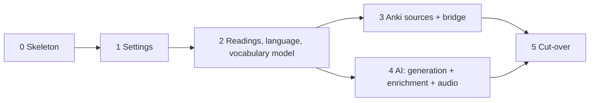

# Monosai in Rust — Migration Guide

Status: proposal, 2026-11-02
Companion documents: [architecture.md](architecture.md) (the target),
[style.md](style.md) (how code is written)

This guide says how to move from today's Angular + TypeScript application and
Kotlin bridge to the target architecture. It assumes:

- **No backwards compatibility.** Existing IndexedDB data is dropped. Cache
  keys, hashes, prompt versions, and the bridge contract start fresh.
- **The UI stays.** Components, templates, styles, routing, and the design
  system are kept. Stores keep their public surface where reasonable.
- **Zero real users.** The app may be broken on the migration branch for a
  while; `main` keeps deploying the old app until the cut-over.

---

## 1. Strategy

### 1.1 Rewrite in vertical slices on one branch

A strangler-fig migration (old and new side by side, piece by piece) is the
right tool when data and users must survive. Neither has to here, and running
Dexie and SQLite side by side would cost more than it saves. Instead:

1. Create `rust-engine` from an up-to-date `main`.
2. Build the new engine in **vertical slices**: each slice takes one area from
   the engine API through workflows, pure rules, and handles to SQLite,
   switches the matching Angular stores to the engine, and deletes the TS code
   it replaced.
3. A slice is done when its Playwright journeys pass against the new engine.
4. When every journey passes, merge to `main`. That merge is the cut-over.

Feature work on `main` is frozen for the duration, so the branch never has to
chase moving TS code.

### 1.2 The finish line

The existing Playwright journeys (desktop and Android lanes, plus the PWA
offline suite) are the acceptance test. They describe behaviour, not
implementation, so they survive the rewrite with one change: journeys that
seed data through Dexie seed through a debug-only engine call instead.

### 1.3 Order of slices



Slice 2 includes the vocabulary model and pasted word lists, because the
reader cannot show token statuses without them. Slices 3 and 4 are then
independent and can run in parallel sessions (different crates, different
stores).

### 1.4 The rule that holds throughout

From slice 0 on, every Rust change follows the
[style guide](style.md) and passes `cargo xtask check`. The style
guide is in the repository before slice 0 starts, so the first crate is
already written to it.

---

## 2. Before starting

### 2.1 Machine setup (once)

Rustup is the only machine-level install. Everything else is project-local.

```bash
rustup show
```

(`rustup show` installs the toolchain and targets named in
`rust-toolchain.toml` the first time it runs in the repository.)

Project-local cargo tools:

```bash
cargo install --locked --root .tools wasm-bindgen-cli --version <exact version from Cargo.lock>
```

```bash
cargo install --locked --root .tools cargo-nextest cargo-deny cargo-hack cargo-about cargo-llvm-cov cargo-ndk cargo-shear cargo-mutants
```

`npm run worktree:setup` is extended to run these so a new worktree gets them.
`binaryen` (for `wasm-opt`) is added as an npm devDependency. The scheduled
fuzz job installs its pinned nightly and `cargo-fuzz` itself; nobody needs
them locally.

For the bridge: the Android NDK through the SDK manager, version pinned as
`ndkVersion` in `apps/android/app/build.gradle.kts`.

### 2.2 Unknowns are checked where they first matter

A few assumptions of the architecture are unproven. There is no separate
experiment phase: each one is part of the done criteria of the slice that
first depends on it, and the architecture document (section 20) names the
fallback if it fails. A failed check is investigated and decided in that
slice, and the outcome is written into the architecture document's open
questions table.

| Check                                                                         | Slice | Fallback                                                         |
| ----------------------------------------------------------------------------- | ----- | ---------------------------------------------------------------- |
| The lint set passes on wasm-bindgen output without `allow`                    | 0     | `engine-wasm` declares its own lint table                        |
| Generated TS types are clean; every payload rejects unknown fields            | 0     | `ts-rs` writing committed `.ts` files                            |
| `rust-lld` links the workspace on Windows                                     | 0     | Default linker                                                   |
| SQLite on OPFS keeps data across reloads on desktop **and** a real Android phone | 1  | `sqlite-wasm-rs` directly behind the same `Db` API               |
| The runtime model holds under concurrent requests and a long job              | 2     | A single owner task reading a message channel                    |
| Engine and language wasm sizes fit the startup budget                         | 0, 2  | Lazy prompt assets; stay on Lindera 2.x                          |
| A package collection loads through SQLite deserialize                         | 3     | A temporary in-memory VFS file                                   |
| uniffi callbacks work from the tokio thread                                   | 3     | A Kotlin-side executor and a channel                             |

---

## 3. Slice 0 — Skeleton

**Goal:** the workspace exists, the style guide is in force, CI runs it, an
empty engine boots in a worker, and Angular talks to it.

### Steps

1. **Move the apps.**
   - `git mv web apps/web`, `git mv android-bridge apps/android`.
   - Update the root `package.json` scripts (`npm --prefix apps/web …`),
     `.github/workflows/*`, `scripts/`, `.claude/launch.json`, docs links,
     `worktree-ports.mjs` paths, and the bridge release workflow's source list.
   - Commit this move on its own so history follows the files.
2. **Read the design documents** in `docs/rust/`: the style guide, the
   architecture, and this guide. They are already committed on the branch.
3. **Create the workspace.**
   - Root `Cargo.toml` with `members = ["crates/*/*", "xtask"]`,
     `resolver = "3"`, `[workspace.package]` (edition 2024, licence,
     rust-version), `[workspace.dependencies]` (all with
     `default-features = false`), `[workspace.lints]` from the style guide,
     and the profiles from the architecture.
   - `rust-toolchain.toml`, `rustfmt.toml`, `.cargo/config.toml`,
     `clippy.toml`, `deny.toml`.
   - `.gitignore`: `/target`, `/.tools`, `apps/web/src/generated/`.
4. **Create `xtask`** with `new-crate` (kinds `pure`, `handle`, `glue`),
   `check`, `check-layers`, `test`, `wasm`. Use `cargo metadata` (via the
   `cargo_metadata` crate) for `check-layers` and `test --changed`.
   `check-layers` enforces the group rules and the pure-crate dependency
   allowlist.
5. **Create the first crates** with `xtask new-crate`: `kernel/kernel`,
   `sys/platform`, `engine/engine-api`, `engine/engine`, `engine/engine-wasm`.
6. **Engine boot.**
   - `engine-api`: `Request`, `Response`, `Cancel`, `Event`, `ErrorDto`, and one
     call: `Ping`.
   - `engine`: `Engine` with the `Requests` handle and the event channel;
     `handle(Request) -> Response`.
   - `engine-wasm`: `#[wasm_bindgen] struct EngineHandle` with
     `EngineHandle::start(emit: js_sys::Function)` and
     `handle(&self, msg: JsValue) -> Promise`; the `tracing` subscriber.
   - `platform`: `Locks`; a second tab gets a typed refusal.
7. **Angular side.**
   - `apps/web/src/app/engine/engine.worker.ts` (shim),
     `engine-client.ts` (request ids, pending map, cancel, events),
     startup step in `core/` that boots the engine before routes render and
     shows the "open in another tab" screen on refusal.
   - Vitest: a fake `EngineClient` for store tests.
8. **Build integration.**
   - `npm start`, `npm test`, `npm run build`, `build-if-stale.mjs` run
     `cargo xtask wasm` first and include `crates/` and `Cargo.lock` in their
     inputs.
   - Add the engine wasm to `ngsw-config.json`'s prefetch group.
   - Measure the engine wasm and add a gzip budget for it to
     `bundle-budgets.json`.
9. **CI.** Add the `rust` job (`xtask check`, `xtask test`,
   `wasm-bindgen-test`), make `build` run `xtask wasm --release`, add `rust`
   to `gate`'s `needs`.
10. **Licences.** `cargo-about` output is merged into the existing licence
    check so the shipped notice covers Rust dependencies.
11. **AGENTS.md.**
    - Before writing Rust: read `docs/rust/style.md`. New crates only via
      `cargo xtask new-crate`; dependencies only in `[workspace.dependencies]`.
    - Verifying: `cargo xtask check` and `cargo xtask test` alongside
      `npm test`.
    - Code rules: lints are overridden only with `#[expect(lint, reason =
      "…")]`; committed SQL migrations are immutable.
12. **ADR.** Write the ADR "Rust engine in a worker" (section 8 lists what it
    supersedes), and the ADR "Functional core and handle types" recording the
    runtime model and the deviations listed in the style guide.

### Done when

- `npm test`, `npm run e2e`, and CI `gate` are green.
- The app starts, the engine answers `Ping`, a second tab shows the refusal.
- `cargo xtask check` passes, including layer rules, the pure-crate allowlist,
  and per-package builds, with no `allow` in `engine-wasm`.
- The generated TS types for `Request`, `Response`, and `Event` type-check in
  Angular without casts, and a test rejects an unknown field in every
  payload.
- The workspace links with `rust-lld` on Windows, or the default linker is
  configured and the reason recorded.

---

## 4. Slice 1 — Settings and credentials

**Goal:** prove the full pattern on the simplest area: engine API, workflow,
pure rules, handles, SQLite repository, migration, store, events.

### Crates

`kernel/text`, `kernel/cache-key`, `domain/settings`, `app/settings-app`,
`store/sqlite`, `store/store`, `sys/transport`, `ai/ai-wire`,
`ai/openrouter`, `ai/model-catalog`.

### Steps

1. `store/sqlite`: the `Db` handle: open on OPFS (wasm) or in memory (native,
   `test-util`), pragmas, `read`/`write` closures, the migration runner,
   migration `0001_settings.sql` (settings, credentials). Failed migration →
   `ErrorDto { domain: storage, code: "migration-failed" }` → recovery screen
   with explicit reset.
2. `domain/settings`: settings shapes, model selection, tested-configuration
   fingerprints (`cache-key`). Pure.
3. `store/store`: `store::settings` and `store::credentials`.
4. `sys/transport`: `Transport` over `fetch` with capped streaming reads,
   deadlines, and abort on drop; `Transport::scripted()` under `test-util`.
5. `ai/ai-wire` and `ai/openrouter`: wire types; the client, error mapping,
   `retry::decide` (pure) and the retry loop, `VerifiedOpenRouterUrl`,
   `SecretString`.
6. `app/settings-app`: load, save, set API key (write-only), test
   configuration, model catalog.
7. Engine calls: `GetSettings`, `SaveSettings`, `SetApiKey`, `HasApiKey`,
   `ListModels`, `TestTextModel`, `TestVoiceModel`. Event: `SettingsChanged`.
8. Angular: `AppSettingsStore` and the AI settings stores call the engine;
   delete their Dexie repositories and the TS OpenRouter client parts they no
   longer use.
9. On first launch, delete the old `monosai` IndexedDB database. Log it once.

### Done when

- Settings journeys pass; the key is never visible in any engine reply (a
  native test serializes every `Reply` and `Event` built during a settings
  flow and asserts the key does not occur).
- `settings-app` tests run against in-memory `Db` and a scripted transport,
  with no test doubles of project code.
- A saved setting survives a reload in desktop Chrome and, checked once by
  hand, in Chrome on a real Android phone. The chosen journal mode is
  recorded in the architecture document.

---

## 5. Slice 2 — Readings, language, and the vocabulary model

**Goal:** import a text, tokenize it, store it, open it in the reader with
statuses and furigana, look up words, and mark known words from a pasted list.
This is the core of the app.

### Crates

`domain/language`, `domain/reading`, `domain/grammar`, `domain/vocabulary`,
`domain/jobs`, `japanese/ipadic`, `japanese/tokenizer`, `japanese/dictionary`,
`japanese/analyzer`, `engine/language-wasm`, `app/reading-app`,
`app/vocabulary-app` (list sources only).

### Steps

1. **Language.**
   - Port `ipadic-mapping`, `ipadic-inflection`, `ipadic-conjugation` into
     `japanese/ipadic` with their specs.
   - `japanese/tokenizer`: Lindera with `embed-ipadic` → `RawToken`, offsets
     as `Utf8Offset`.
   - `japanese/dictionary`: the index and lookups.
   - `language-wasm`: exports `tokenize` and `lookup`; built by `xtask wasm`
     as a separate, digest-verified, versioned asset.
   - `japanese/analyzer`: the `Analyzer` handle; the wasm implementation loads
     the module on `ready()`, the native one links `tokenizer` and
     `dictionary`, the `test-util` one returns fixed tokens.
   - Port the golden corpus as a native test of `tokenizer` + `ipadic`.
2. **Reading domain.** Readings, paragraphs, sentences, tokens, segmentation,
   structural baseline, paragraph window, token status. Pure. Port each TS spec
   alongside the code it tests.
3. **Vocabulary model.** Snapshots, expression identity, deduplication,
   classification of tokens against a snapshot. Pure. Pasted-list sources and
   snapshot commit in `vocabulary-app`.
4. **Jobs.** `domain/jobs`: the scheduler state machine, with property tests
   for one-step-in-flight, join, yield, park, stop, and the priority lane. The
   engine's job driver runs import analysis as steps with progress events.
5. **Reading workflows.** Import, list, open, window, rename, delete, declare
   targets. Migrations `0002_readings.sql` (readings, paragraphs, sentences,
   tokens, frozen evidence) and `0003_vocabulary.sql`. Summaries denormalized
   on `readings`.
6. **Engine API.** `ImportText`, `ListLibrary`, `OpenReading`,
   `ReadingWindow`, `LookupWord`, `RenameReading`, `DeleteReading`,
   `DeclareTargets`, `ImportWordList`. View models carry statuses, furigana,
   and `Utf16Offset` ranges, built in `engine::views` and snapshot-tested.
   Events: `ReadingChanged`, `LibraryChanged`, `VocabularyRevised`,
   `JobProgress`.
7. **Angular.** Library, import, reader, and word-list stores call the engine.
   The reader's paragraph window directive asks the engine for windows instead
   of Dexie.
8. **Delete** the language worker, its host, `lindera-wasm-web-ipadic`, the
   reading and word-list Dexie repositories, and the TS domain code they used.

### Done when

- Import, library, reader, dictionary, word-list, and reading-performance
  journeys pass.
- The offline PWA suite opens a saved reading and looks up a word with the
  network off.
- A `wasm-bindgen-test` proves the runtime model: a library query is answered
  while a long import is analysed, cancelling a request aborts its fetch, and
  concurrent requests cause no borrow error.
- The language wasm size is recorded and has a budget.

---

## 6. Slice 3 — Anki sources and the bridge

**Goal:** vocabulary sources from Anki Desktop, the Android bridge, and
package files; mapping; automatic sync.

### Crates

`anki/anki-wire`, `anki/anki-connect`, `anki/zip-reader`, `anki/anki-package`,
`anki/anki-markup`, `bridge/bridge-http`, `bridge/bridge-ffi`, the rest of
`app/vocabulary-app`; the `loopback` feature of `sys/transport`.

### Steps

1. **`anki-wire`.** Port the AnkiConnect subset from `protocol/actions.md`,
   `AllowedRead`, envelopes, `CONTRACT_VERSION = 1` (fresh start). Move
   `protocol/fixtures/` into the crate and test serialization against them.
   Delete `protocol/`.
2. **Package reading.** Port the hand-written ZIP reader to `zip-reader` over
   `&[u8]` (keep every safety check, each limit a documented constant; add a
   fuzz target). `anki-package` uses `ruzstd` and loads the collection into
   an in-memory, read-only database through SQLite deserialize. Port the synthetic Anki fixtures; keep the manual Kaishi test as an
   ignored test.
3. **Markup.** `anki-markup` with the `html5ever` tokenizer; port the
   `dom-markup-text` specs as cases.
4. **Live client.** The `AnkiConnect` handle for Desktop and the bridge,
   including the first-review and FSRS difficulty searches.
5. **Vocabulary workflows.** Anki and package sources, mapping suggestion and
   confirmation, provenance, atomic commit, browse query, reader word lists,
   automatic sync on return (cooldown, join, one follow-up), with the timing
   rules as pure functions over `Timestamp`s.
6. **Bridge, Rust side.** `bridge-http`: the pure request policy
   (`policy::decide`), hyper serving on a single-threaded tokio runtime,
   loopback only. `bridge-ffi`: uniffi `start`/`stop`/`AnkiReads`, adapting
   the generated callback object to the core trait. Fuzz target on the
   request policy.
7. **Bridge, Kotlin side.** `BridgeService` calls `BridgeCore.start`;
   `ContentProviderReads` implements `AnkiReads`; delete `http/*.kt`,
   `AllowedReads.kt`, Ktor, kotlinx-serialization. `xtask android` builds both
   ABIs and the Kotlin bindings before Gradle.
8. **Contract test.** Native test: `bridge-http` with a fake `AnkiReads` on
   loopback + `AnkiConnect` over the loopback transport, running a full
   vocabulary read.
9. **Angular.** Vocabulary, source page, browse, mapping, and reading-level
   stores call the engine. The share-target inbox hands the shared file's bytes
   to `ImportPackage`.
10. **CI.** The `bridge` job runs `xtask android`, Gradle tests, APK assembly,
    and a 16 KB alignment check on the `.so` files. The bridge release
    workflow's source list includes `crates/anki/anki-wire`,
    `crates/bridge/*`, `crates/kernel/*`.

### Done when

- Vocabulary, Anki mapping, package import, share-target, and reader-marking
  journeys pass.
- A debug APK on an emulator serves the PWA through the Rust listener, with
  the reads arriving from the tokio thread through the uniffi callbacks.
- The deployed build, served from its public origin, reads from the bridge on
  a phone.
- `sql.js`, `fzstd`, and the package worker are gone.

---

## 7. Slice 4 — AI: generation, enrichment, audio

**Goal:** plots, stories, translation, grammar review, speech, and the
preparation lane.

### Crates

`domain/story`, `domain/enrichment`, `app/generation-app`,
`app/enrichment-app`, `ai/prompts`, `ai/task-plot`, `ai/task-story`,
`ai/task-translation`, `ai/task-grammar`, `ai/task-exception`, `ai/speech`,
`audio/audio-codec`, `audio/webm`; `OpusEncoder` in `sys/platform`.

### Steps

1. **Prompts.** Port prompt layers and the Markdown input wire into
   `ai/prompts`. Prompt versions restart at 1. `insta` snapshots for every
   prompt.
2. **Tasks.** One pure crate per task: a request builder, a structured-output
   type deriving `serde` + `schemars`, and a parser. The reply is parsed into
   the same type the schema came from. Port the response-schema specs as
   fixture tests (valid, invalid, truncated, wrong-type replies).
3. **Story domain and generation.** Practice selection, story structure, plot
   choice before story, validation against vocabulary, repair, assembly as
   pure functions; backgrounded generation and extending a reading while it is
   generated as job steps in `generation-app`.
4. **Enrichment.** Translation with frozen terminology, grammar review, audio
   as job steps; cache keys from `cache-key`; staleness against profile and
   configuration as pure functions. Migration `0004_enrichment.sql`.
5. **Audio.** `speech` builds requests; `audio-codec` decodes and verifies;
   `OpusEncoder` wraps WebCodecs `AudioEncoder`; `webm` muxes; clips stored as
   BLOBs. Engine replies carry clip bytes; playback stays in the TS playback
   stores.
6. **Engine API.** Generation, plot, enrichment, preparation, and audio calls;
   `JobProgress` events for all three layers.
7. **Angular.** Generation, plot, preparation, reader aids, reader audio, and
   playback clip stores call the engine. Playback transport and navigation
   stay TS.
8. **Delete** the TS OpenRouter adapters, prompts, enrichment and generation
   stores' logic, the speech encoder worker, `@openrouter/sdk`.

### Done when

- Generation, translation, grammar, audio, and player journeys pass (with the
  recorded-provider fixtures the journeys already use).
- A native engine test runs import → generate → translate → synthesize
  against in-memory SQLite, the native analyzer, and recorded replies.

---

## 8. Slice 5 — Cut-over

### Steps

1. **Delete the remains:** `apps/web/src/app/domain/`, `application/`,
   `infrastructure/`, `src/workers/`, and their specs; Dexie, Zod,
   `fake-indexeddb`, `sql.js`, `fzstd`, `lindera-wasm-web-ipadic`,
   `@openrouter/sdk`, `@types/sql.js`, `@types/emscripten`.
2. **ESLint zones.** Replace `layerZones` with the new TS layout:
   `features` and `shared-ui` may import `state`; `state` may import `engine`
   and `platform`; nothing imports `src/generated` except `engine` (types may
   be imported anywhere with `import type`).
3. **Docs.**
   - Rewrite arc42 chapters 2, 4, 5, 6, 7, 8, 10, 11 for the new architecture
     (the architecture document is the source).
   - New ADRs: SQLite on OPFS with single-tab ownership; crate layout and
     dependency rules; `anki-wire` as the bridge contract; structured output
     from Rust types; Rust bridge listener.
   - Mark superseded: 0002 (hashing and canonical JSON), 0003 (ESLint
     boundaries), 0004 (Dexie persistence shape), 0005 (tokenizer packaging),
     0016 (package parsing libraries), 0042 (cross-tab mutations), 0078 (contract
     negotiation), 0085 (SHA-256 padding), and any other whose mechanism is
     gone. Their reasoning stays as history.
   - Bridge README: build with `xtask android`; NDK requirement.
4. **AGENTS.md.** Replace the Dexie schema rule with the SQL migration rule;
   point the persistence and contract reading lists at `store/sqlite`,
   `engine-api`, and `anki-wire` crate docs.
5. **Merge** `rust-engine` into `main` with `gate` green. The first deploy
   deletes the old IndexedDB database on launch.

### Done when

- No TypeScript file outside `features/`, `shared-ui/`, `core/`, `state/`,
  `engine/`, `platform/`, and tests remains.
- `npm run verify` and `gate` are green; the PWA suite passes offline.

---

## 9. How to port one piece of TypeScript

The same recipe applies to every file, and works well for coding agents:

1. **Read the TS file and its spec.** The spec is the behavioural
   specification; the TS structure is not.
2. **Separate decide from do.** List what the code decides (rules) and what it
   does (reads, writes, requests, timers). Rules become pure functions in a
   `domain/*` or pure crate; effects stay in the workflow.
3. **Write the Rust types first.** Hand-written newtypes for ids, offsets,
   counts, and names; enums for every union; `Option` for optional fields;
   no `bool` parameters.
4. **Port the spec cases as Rust tests** before porting the code, against the
   pure functions where possible. Keep the case names so the mapping stays
   obvious.
5. **Port the code.** `Result`-shaped returns become `Result<T, E>` with a
   per-operation error enum; thrown errors become variants; impossible states
   become types or `expect` with the invariant; Zod schemas become wire types
   with `deny_unknown_fields` and validating newtypes.
6. **Add property tests** where the TS spec only had examples (offsets,
   window bounds, selection, scheduling, cache keys).
7. **Run `cargo xtask check` and `cargo xtask test --changed`.**
8. **Switch the caller** (engine route or store) and delete the TS file and
   its spec in the same commit.

What not to port literally:

| TypeScript                                   | Rust                                                                       |
| -------------------------------------------- | -------------------------------------------------------------------------- |
| A class with `inject()`ed services           | Free functions; handles passed as `&` parameters                           |
| Port interfaces with fake implementations    | Pure functions tested with values; handle `test-util` variants for effects |
| Signal stores' internal state machines       | A pure state machine in a domain crate; the TS store only mirrors replies  |
| An event bus or `Subject` that others watch  | Workflows return outcomes; the engine emits events                         |
| `AbortSignal` passed through every call      | Dropping the future                                                        |
| `Promise` chains with `try/finally` cleanup  | A guard whose `Drop` does the cleanup                                      |
| `structuredClone`/spread copies              | Borrow the input, return a new value                                       |
| `Date.now()`, `crypto.randomUUID()` inline   | `Timestamp` and `Id<K>` parameters, produced by `Clock` and `Ids`          |
| Comments naming the old TS file              | Docs describing what the Rust code does                                    |

---

## 10. Commit and branch conventions during the migration

- Commit format stays `<type>(<scope>): <summary>`. New scopes: `engine`,
  `kernel`, `domain`, `sys`, `store`, `ai`, `anki`, `japanese`, `audio`,
  `bridge`, `xtask`, plus the existing UI scopes.
- One slice may span many commits; each commit builds and passes
  `cargo xtask check`.
- Docs for a slice are updated in the slice, not at the end.
- `main` receives only fixes needed to keep deploying; nothing is ported back.

---

## 11. Risks

| Risk                                                     | Mitigation                                                                                              |
| -------------------------------------------------------- | ------------------------------------------------------------------------------------------------------- |
| OPFS SQLite does not behave on Android Chrome            | Slice 1 is checked once on a real Android phone                                                         |
| The runtime model breaks under concurrent requests       | Proven by a test at the start of slice 2, while only slices 0–1 depend on it; the fallback is a single owner task |
| A worker crash (wasm trap) loses in-flight work          | Input never panics; job steps persist before reporting progress, so a reload resumes them               |
| Engine wasm too large for the startup budget             | Measured in slices 0 and 2; lazy prompt assets; `opt-level = "z"`, `wasm-opt -Oz`                        |
| Single-tab ownership annoys during development           | The "take over" button; Playwright tests use one tab per context                                        |
| Journeys rely on Dexie seeding                           | Debug-only `engine-api` seeding call, behind a cargo feature that release builds do not enable          |
| Bridge APK and PWA released at different times           | `CONTRACT_VERSION` check with a clear "update the bridge" message                                       |
| Workflows recompile often when a handle crate changes    | Measure; if needed, narrow traits with generic workflow parameters (never trait objects)                |
| Agents drift from the style guide                        | The lint set, `check-layers` with the pure-crate allowlist, and `xtask new-crate` templates encode it   |
| Branch lives long and diverges from `main`               | Feature freeze on `main` for the duration                                                               |
